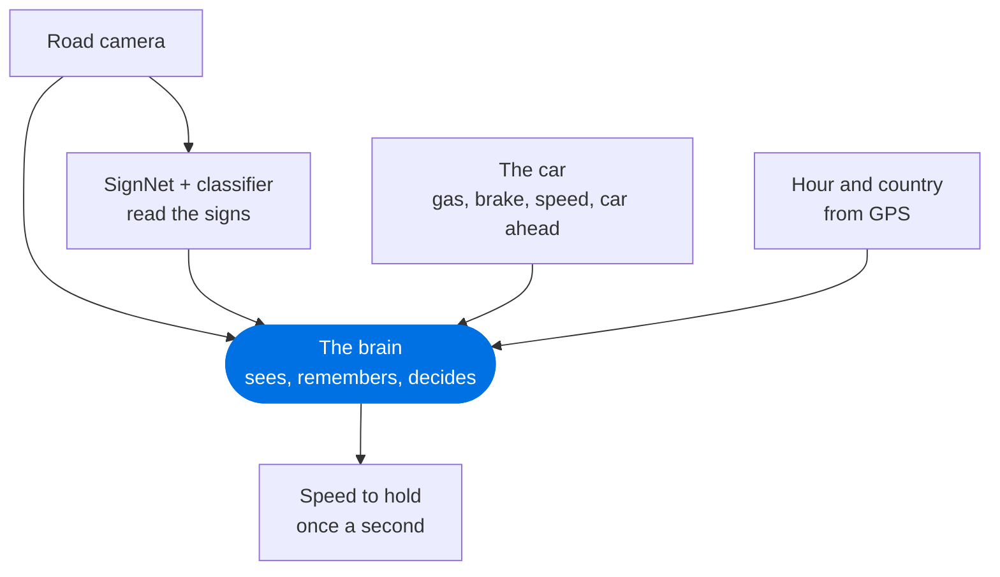
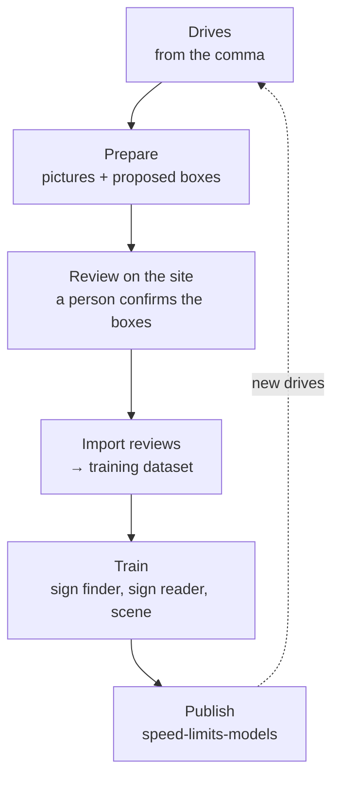
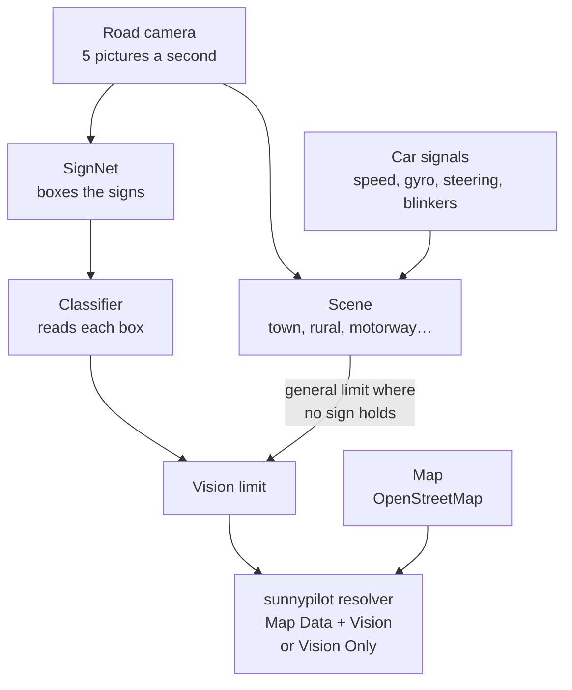

# sunnypilot.speedlimits

**A camera speed limit for sunnypilot**, an openpilot fork for driver assistance, on a comma 4. Small neural networks read the Swiss speed signs in the comma's road camera, and a [brain](#the-brain) decides the speed to hold. This repository holds the website where drives are reviewed, and the tools that train those networks and send them to the car.


<sub>The review page. You check the box around each sign, and what the sign says.</sub>

> **Status: research.** A research build of sunnypilot runs these networks on Cristian's comma 4. One choice in sunnylink turns them on: **Smartspeed**. The brain then chooses the speed, the map fills in where vision has none, and the car's set speed is only on and off. Details: [what runs on the comma now](docs/NN_VISION_SPEED_LIMIT_REMAINING_WORK.md#60-what-runs-on-the-comma-now-28-oct-2026).

[Why](#why) · [The brain](#the-brain) · [How it works](#how-it-works) · [Daily use](#daily-use) · [Install](#install) · [More](#more) · [Details](#details)

## Why

sunnypilot's Speed Limit Assist takes the limit from the car (when the car sends it on CAN) or from the map (OpenStreetMap). Many cars send nothing on CAN. Cristian's Peugeot 3008 is one of them, so the map is all it has.

Maps lag behind the road. Roadworks, variable motorway displays and new signs are often missing or wrong on the map. The sign at the roadside is what the driver must follow. A camera can see it.

## The brain

**One network with memory decides the speed to hold, the way a driver does.** A sign is a strong hint, not the last word: the brain also sees the road, remembers what it has passed and knows what the car is doing. There are no hand-written rules behind it, and it never reads the map.



It learns from people, not from the map: in **Speed review** a person marks the speed really worth holding, stretch by stretch, and those speeds are its answers. The aim is what fixed rules cannot do, such as letting go of a roadworks limit that never gets an end sign.

Where it stands: the first brain is in the release on Cristian's comma. On places kept out of training it gets 83-90 % of the frames right, on a small test of 438 frames, and for now it mostly says what the sign says. Roadworks need more labelled sites. [How it is built and measured](docs/NEURAL_NETWORK.md#the-brain-4-november-2026).

## How it works

Three networks: the **sign finder** (SignNet, also called the *cutter*) puts a box around each sign, the **sign reader** (the *classifier*) reads each box, and the **scene** network says what kind of road the car is on.

From a drive to the car, in six steps:



- **Prepare** takes one picture a second from each drive. A model proposes a box around each sign it sees.
- **Review** is the only step done by hand. Every label the networks learn from is confirmed here.
- **Import reviews** copies the confirmed labels (the boxes and what each sign says) into the training dataset ([what it does](#4-import-the-reviews)).
- **Train** teaches the networks on a GPU on the server. The car never trains anything.
- **Publish** puts the networks in use into sunnypilot. The comma gets them with its next software update.

### What runs on the car

This is the chain of a release without a brain. With one, the [brain](#the-brain) takes the place of the scene network and of the rules below.



- **SignNet** looks only at a band at the top of the picture, where signs stand (896 × 288 pixels, a grid of 8 pixels). It keeps up to 5 boxes per picture.
- The **classifier** reads each box: a speed and its value, end of limit, another kind of sign, or "not a sign". A number counts once it is read in 2 pictures within 1.5 s.
- The **scene** network says what kind of road it is: town, 30 zone, rural, expressway, motorway, ramp, the acceleration lane after it, car park or garage. Where no sign holds, that gives the country's general limit; from the acceleration lane on, the carriageway's, not the ramp's. In Switzerland: 50 in town, 80 rural, 100 expressway, 120 motorway, 20 in a car park, 10 in a garage.
- Everything runs inside the comma 4, on its own GPU, next to the driving model.
- **Full definition, for far signs and plates.** Two Developer switches, both off by default. **Record road at full resolution** writes `fcamera.hevc` at 2688 × 1520, and the server then keeps that frame beside each picture for Sign review and the classifier's training ([the guide](docs/GUIDE.md#drives-at-full-definition)). **Read signs at full resolution** has the cutter search the 1344 × 760 frame as always and cuts the classifier's crop from the 2688 × 1520 one. With either one on, the road camera goes through the BPS: the driving model then reads that picture too.
- **The vision side never reads the map.** It uses only the camera and the car's own signals. Map and vision meet only in sunnypilot's resolver, with **Smartspeed** (Map Data + Vision); the old Vision Only takes the vision limit alone.

### The rules on the car

How the readings become the limit (`SpeedLimitMemory` in `sunnypilot/speed_limits/vision.py`, branch `speed-limits` of cristianku/sunnypilot). The numbers are the defaults; the ones marked *setting* can be changed on the site, **Models › On the car**.

**The brain.** A release with a brain (Models › Brain, then Publish) replaces everything below up to Speed Limit Assist: the network says the speed itself, once a second, and speedvisiond publishes it as the vision limit (`brain.py`, `speedLimitReason` "brain"). "Map Data + Vision" stays the one choice in sunnylink and the resolver does not change. The brain always says a number, so while it runs the map is not used. What it gets: the picture, the signs read (`brain_inputs.py`), the car ahead, the local hour and the country from GPS, and by default gas, brake and the car's speed; never the map. It gets the plates of hours only if its training had them (`plates` in its contract, shown in Models › Brain). If it does not load, or was trained with another `brain_inputs.py`, speedvisiond sends nothing and the resolver falls to the map. A release without a brain runs the rules below.

**Signs**

- A number counts once it is read in 2 pictures within 1.5 s (*settings*), the classifier at least 70 % sure (*setting*). Two at once (a gantry, roadworks): the one seen most; on a tie, the lower.
- A number with a plate of hours (the class `maximum_speed_hours:30`, or `maximum_speed_hours:30:22-6` when the hours were read; disc and plate in one box) counts as its number, at any hour: only the brain weighs the hours, and gets them as an input when the class says them. Its distance comes from the width of the box, since the box is taller than the disc.
- The networks read only the digits; the unit is the country's: mph in the UK, the US and the places that follow them, km/h everywhere else (`vision.sign_unit`). The country is the one GPS confirmed at the borders once a release has them (none has yet), else the one chosen in Settings › OSM, Switzerland when none.
- A number holds until the next sign. The end of a limit gives the general limit of the road the car is on, or none if that is not known.
- Town entry and exit, motorway and expressway start and end set the general limit of that road. In Sweden, Norway and Finland they only say which road it is: the limit held stays.
- On the comma 4 screen one speed-limit square shows, on the right, clear of the steering wheel: the fuchsia vision square, with the road type on top. It never reads the map. The final limit is not drawn (5 Nov 2026): where vision has none the resolver takes the map all the same, and the square shows a dash.
- The distance to the sign ahead (a number, the end of a limit, a motorway or expressway sign or its end) shows in the fuchsia square in place of the eye ("42 m"), for the driver to check, and a limit read on that sign starts from it (next rule). It comes from the sign's size on the camera, corrected by the metres driven as the sign grows. A round sign's diameter is taken from the kind of road (the usual Swiss sizes, still to be checked: 60 cm in town, 80 cm outside, 100 cm on expressways, 120 cm on motorways); a motorway or expressway sign is measured by its height, 1.7 m to start with and held more loosely, because its formats differ (about 1.3 m on a post and 2.1 m on a gantry on our drives, still to be checked). With several signs in the picture, the nearest by its size. The motorway end only gets a distance once the classifier knows that sign (the next training). A gantry's LED limit (a number lit on a variable display; not one that is off) is round too, 1.4 m across (*setting*): the median of 10 approaches on our drives, from how its box grew with the metres driven. Once the sign has left the picture the metres driven are counted down; it goes when the car passes the sign, or 15 s after it was last seen. The number shown is shorter by 0.34 s of the speed plus 6.8 m (*settings*), so that it reaches zero where the sign leaves the picture: without it the zero came about 6.5 m late on 28 signs marked by hand (the frame is old when read, the networks take their time, each value stays 0.2 s on the screen), about 2 m off with it (3 Nov 2026). How late or early that countdown reaches zero, against the frame where the sign leaves the picture marked by hand, is measured in **Data › Sign distance** (from the car's own logs and video, never the map): a change to the countdown is a change of `vision.py`, measured again there.
- A limit read on a sign ahead starts at the sign, as the map's does (`vision.LimitAhead`, 4 Nov 2026): a number, the end of a limit, a motorway or expressway sign or its end. From the moment it is confirmed until the car gets there, `speedVisionSP.speedLimit` stays the limit held, and the new one goes out as `speedLimitAhead` with `speedLimitAheadDistance`, the same two data the map sends. The metres are taken at that moment and counted down with the metres driven; the distance on the same sign can correct them, upwards by 5 m at most, so the next sign further on cannot hold the limit. A limit with no sign ahead applies at once: another rule (the scene, a car park, the end of a ramp), a sign with no distance (a town sign), or the first limit of a drive. The fuchsia square shows the number just read at once, as before; the final limit changes with the resolver. Replayed on the logs of two drives with the distance (21 changes, 10 of them higher limits), a higher limit waited 4.3 s at most; where the wait ends is as accurate as the distance, measured in **Data › Sign distance**.

**Ramps and carriageways**

- A number read on a ramp, or within 45 s of a motorway or expressway sign (*setting*), is the ramp's.
- It ends at the acceleration lane when the carriageway is known from its sign, otherwise after 8 s of acceleration lane or carriageway (*setting*). Then the carriageway's general limit comes back, so the car can join the traffic. Without the scene network it holds until the next sign.
- A number read off the carriageways (in town, on a rural road, before a ramp the scene network missed) ends once the scene network has seen the motorway or expressway for 10 s (the *setting* of a new road type): a missed end sign must not keep the car at 40 or 60 on the motorway. A number read less than 5 s (*setting*) before the network saw the carriageway may already be the carriageway's (the network lags a few seconds) and holds.
- Roadworks on the carriageway hold: their sign is read on the carriageway, and repeated there.

**The scene, where no sign holds**

- The scene network's answer counts after 3 equal answers in a row, one a second (*setting*).
- A green board towards a motorway or expressway (`other_sign:motorway_direction`: places, arrows, the motorway pictogram on a direction board) never sets a limit: in Switzerland it stands at the start of the entry ramp, where the limit is not yet 120. Confirmed as a sign is (2 pictures within 1.5 s), it only gives the scene network one more input, the seconds since the last board, from which the network learns that a ramp or a motorway is coming. Only a scene network trained with that input reads it, and only with a classifier that has the class; until then the input stays "no board".
- At the start of a drive, or out of a car park, the road type gives its general limit. Such a limit follows another road type only after 10 s of it (*setting*). A sign always wins over the scene.
- A 30 zone (the network at least 90 % sure, *setting*) seen for 10 s after the last sign lowers a town's 50 to 30. A higher number read (60, 80) holds: the network can be wrong.
- A car park: seen for 5 s below 25 km/h (*setting*), it gives 20 km/h in the open and 10 km/h in a garage (*settings*) and drops the road's limit before; inside, a sign counts only when lower. Out of it, a road seen for 3 s (*setting*) gives that road's limit.
- General limits in Switzerland: 50 town, 80 rural, 100 expressway, 120 motorway, 30 in a 30 zone. Other countries are in `IMPLICIT_LIMITS`; Germany has no motorway limit (none is set).

**Speed Limit Assist** (sunnypilot's, changed on `speed-limits` for cars like the Peugeot, with openpilot longitudinal and the car's own cruise)

- **Smartspeed** (sunnylink, 5 Nov 2026) is the one choice, Off or Smartspeed (`SpeedLimitMode` 3), with no separate settings: there is no more Speed Limit Source to pick, and Information and Warning are gone. It starts speedvisiond, shows the fuchsia square and uses **Map Data + Vision** (`SpeedLimitPolicy` 5): the brain's limit, or the map's when it has none. A source without the network moves to that one by itself. With Smartspeed off, **Show Vision Reading** still shows the square, for information only.
- Automatic on every car: the limit applies as soon as it is known. No confirmation and no set speed of 120/130 to confirm with (the Peugeot has no button for it).
- The set speed is only on and off, never the target: the car drives to the limit, also above the set speed, keeps the last limit when it goes, and before any limit keeps the speed at engagement (40 km/h from a stop). Curves and a forced deceleration still win.
- The driving screen shows the word **smartspeed**, white while it drives to a limit and grey without one, left of the vision square, and never the set speed. **+** or **-** on the car does nothing: the word blinks for a second to say so. The press that engages does not count.
- The map (when vision has no limit): a lower limit ahead is taken once the car is within its braking distance at 1 m/s², counted from the higher of the car's speed and the limit in force, and held to the sign. On sunnypilot master this never happens (the GPS age is Unix time taken from the time since boot), so the map slows the car only at the sign; fixed on `speed-limits` and proposed upstream from branch `speed-limit-resolver-gps-clock` (31 Oct 2026). The planner slows down at most 0.5 m/s², so the car still reaches the lower limit a little after the sign.
- Vision's limit ahead goes through the same rule of the resolver (4 Nov 2026): a lower limit is taken within its braking distance, which for a sign read at 30 to 70 m is almost always at once; a higher limit waits for the sign. The distance only decides when the limit switches: Speed Limit Assist sends a target speed, its acceleration from the distance (`get_adapting_state_target_acceleration`) is not used, so the car slows down no harder than with the map.

## Daily use

Everything runs on the server. Most steps are a button on the site and also a script in `helpers/` or `scripts/`. Get the drives, Prepare and Import skip work that is already done; a training started again is a new run.


<sub>The Overview page: what is running, the next step, and how far each stage has got.</sub>

**At any time**, `helpers/status.sh` shows each drive, what is running, the GPU, the disk and the next command. It only reads.

### 1. Get the drives

On the site: the **comma** pill at the top right, then **Download new drives**. In a terminal: `helpers/fetch_comma_segments.sh`.

It copies new drives from the comma over SSH. It drops trips shorter than five minutes, the first and last two minutes of each trip, and any minute in reverse gear; of a new trip those minutes come too, but only their pictures below 25 km/h are kept (a garage, a car park).

### 2. Prepare

On the site: **Data › Drives**, then **Prepare new drives**. In a terminal: `helpers/1_prepare.sh`.

It takes one picture a second, lets a model propose sign boxes, and reads the GPS position and country of each picture. **It takes a while and uses many CPU cores and the GPU.** You choose the model that proposes the boxes under **Found by**: Vietnamese YOLO (the default before any choice), Our networks, or Qwen3-VL (about 17 GB of GPU memory).

For the scene network, **Data › Roads › Find the road types** (`helpers/road_types.sh`) reads the kind of each road from OpenStreetMap, offline. The maps a drive needs (a US state, a neighbouring region) are downloaded from Geofabrik by that same button, and no position of a drive leaves the server. These are proposals: a training learns only what a person confirms or corrects there, and the car never sees the map.

### 3. Review

`helpers/2_review.sh` starts the site on port 8765 and prints its link. On the server it usually runs as the `speedlimits-web` service, always on.


<sub>Data › Sign review: how much is confirmed, and the drives to work on.</sub>

On each picture you:

- move, add or delete boxes;
- say what each sign is, and its speed;
- say whom it is for: **Ours**, **Another** road, or **Unclear**;
- press **Confirm**.

**Apply previous** (key A) copies the boxes of the picture before. **Fit box** (key C, every box of the frame but those moved by hand) snaps rough boxes onto their signs, on the server in a fraction of a second, with no AI. **Car networks** (key T) runs the car's own cutter and classifier on the frame on screen, any frame of the video: what it reads goes straight into the frame's boxes on the right, in fuchsia, with whom each is for from the applicability network, to check and confirm. It also works on a phone:


An AI that sees images can help. **Ask AI** (key I) suggests boxes and saves nothing. **Review with AI** goes through a whole drive; you still confirm its work before it counts. AI assistants such as Claude Code can also review through a REST API or MCP: see [review_instructions.md](review_instructions.md).

**Data › Speed review** is the other review, for the network that will decide the speed: along a whole drive you say the speed the car should really hold, stretch by stretch, starting from the limit the comma's vision held (confirm, correct, or split it where it should have changed). These labels only collect the target: nothing there changes the car or trains. See [the guide](docs/GUIDE.md#2-the-web-panel).

### 4. Import the reviews

On the site: **Data › Training dataset**, then **Import reviews**. In a terminal: `helpers/3_train.sh --dataset-only`.


<sub>Data › Training dataset: what the networks learn from, who confirmed it, and the split.</sub>

What it does:

1. It reads every **confirmed** picture in the review database. Model proposals and pictures nobody confirmed stay out. Pictures saved by the site's own AI reviewer (**Review with AI**) wait for a person, and stay out until confirmed. Reviews saved by an assistant through the REST API or MCP are final, and go in as AI reviews (`ai/<name>`).
2. It writes their labels into the training dataset (`data/annotations/objects.jsonl`). It follows the latest review: a picture reviewed again replaces its old rows, and a withdrawn one is removed. Old rows are archived in `data/annotations/replaced/`, not lost.
3. Boxes that reviewers deleted are kept as rejected proposals. The classifier learns from them as "not a sign".
4. It checks the dataset and splits it into **train**, **validation** and **test**. The test is a set of places kept apart, with a buffer of neighbouring places left out of both, so the networks are measured on roads they never learned.

It is quick and uses no GPU. **It trains nothing**: training is the next, separate step. Confirming a picture does not import it either.

### 5. Train

On the site: **Training**. There is one tab and one button per network. **They all use the GPU**, and only one training runs at a time.

- **Train the cutter** (SignNet): about 80 minutes. Its **Mapillary** switch adds photos of the Mapillary Traffic Sign Dataset, cut once with **Cut the Mapillary windows**: **With Mapillary** (about two hours) or **Mapillary, then ours** (about three hours).
- **Train the classifier**: a few hours. It learns from the false boxes of the cutter in use, so choose a cutter first.
- **Train the scene network**: about 15 minutes (longer the first time). It needs **Find the road types** (step 2) to have run once. It needs no reviewed sign.
- **Train applicability** (is this sign for our road?): about 15 minutes. A prototype.


<sub>A cutter training, followed epoch by epoch.</sub>

Each training writes its results in `data/runs/<name>/`. Nothing is put in use by itself.

### 6. Choose and send to the car

On the site: **Models › Versions**. Every version has its test numbers. **Use this one** picks the version that the other steps use.


<sub>The networks in use, each with its main test numbers.</sub>

To the car:

- **Publish** (**Models › Publish**, one button) publishes the SignNet, the classifier and the scene network or the brain in use into the [`speed-limits-models`](https://github.com/cristianku/speed-limits-models) repository. That is a submodule of sunnypilot's `speed-limits` branch. It then rebuilds Cristian's sunnypilot test branch (`psa-torque-sunny-testing`), in a few minutes. On the comma: **Settings › Software › Check for updates**, then install. The Hugging Face package below it is optional, for other people.
- **Try on the comma now**, on the card of a SignNet, copies that SignNet and the classifier in use straight onto a parked comma over SSH, after checking them with the comma's own code. The scene network stays the build's. They last until the comma's next update. **Back to the build's networks** undoes it.

The **On the car** card holds the comma's settings: how sure a sign must be, in how many pictures, how long a road type must be seen. They travel with the next send.


<sub>Models › On the car: the comma's own settings, sent with the networks.</sub>

### Keep the site up to date

`helpers/update.sh` (or **Update the site** in the server pill at the top right) pulls the code, updates the Python environment when needed and restarts the site. Running trainings keep going.

## Install

You need Python 3.11 or newer. The core has no dependencies.

```sh
git clone https://github.com/cristianku/sunnypilot.speedlimits.git
cd sunnypilot.speedlimits
python3 -m venv .venv && .venv/bin/pip install -e . pytest
.venv/bin/nnslr selftest   # quick check, CPU only
.venv/bin/nnslr review     # the site, on this computer only
```

Without drives of your own the site is empty. [docs/INSTALL.md](docs/INSTALL.md) covers the system packages, the GPU environment, the comma's SSH access and the always-on service.

## Helpers, commands and scripts

Day-to-day work happens on the site, whose buttons run a few helper scripts and the `nnslr` command-line tool. [docs/COMMANDS.md](docs/COMMANDS.md) lists them all: what each one does, what it writes, and which ones use the GPU, install packages or publish anything.

- `helpers/1_prepare.sh`, `helpers/2_review.sh`, `helpers/3_train.sh`, `helpers/update.sh`: the daily steps above. `helpers/status.sh` only reads.
- `scripts/run_signnet.sh`, `scripts/run_classifier.sh`, `scripts/run_road_type.sh`, `scripts/run_brain.sh`, `scripts/run_experiment_b.sh`: the trainings of the Training page (GPU).
- `scripts/send_to_car.sh` and `scripts/try_on_comma.sh`: Publish (to the car) and Try on the comma now.
- `helpers/ai_review.sh` and `helpers/measure_ai_reviewer.sh`: the AI reviewer. Its providers and keys stay on the server.
- `helpers/mapillary.sh`, `helpers/mapillary_windows.sh`, `helpers/mapillary_locations.sh`: the Mapillary Traffic Sign Dataset, as crops for the classifier, as windows for the cutter, and where its photos were taken (CPU; the last one asks the Mapillary API).
- `scripts/train_box_fit.sh`: trains the review page's **Fit box** on the boxes people drew, on the CPU in about 15 minutes.

## More

- [docs/GUIDE.md](docs/GUIDE.md): the daily guide, page by page, with sign-in, the token and common problems.
- [docs/COMMANDS.md](docs/COMMANDS.md): every helper, script and `nnslr` command, and what each one writes.
- [docs/INSTALL.md](docs/INSTALL.md): installing everything from scratch.
- [docs/NEURAL_NETWORK.md](docs/NEURAL_NETWORK.md): the networks, how they are measured, and the results.
- [docs/upstream-training-guide.md](docs/upstream-training-guide.md): the `nnslr` training commands, step by step.
- [review_instructions.md](review_instructions.md) and [docs/API_MCP.md](docs/API_MCP.md): for AI reviewers (REST API and MCP).
- [docs/DATASET.md](docs/DATASET.md): the dataset format and its rules.

## Details

### Where each part stands (30 October 2026)

- **Sign finder (cutter).** SignNet is the one cutter, on the car since 28 October. The one in use, trained on 30 October, finds 68% of the speed signs as the car reads them (IoU 0.5).
- **Classifier.** A version with "not a sign" is trained, measured, and on the car.
- **Scene.** A network with memory: the kind of road from the camera and the car's own motion, one answer a second, and the merge after a ramp. On the car ([details](docs/NEURAL_NETWORK.md#the-road-type-with-memory-29-october-2026)).
- **Applicability** (is this sign for our road, or for another one?). A prototype. Not on the car, so a side road's sign can be taken for ours.
- **Country rules.** The general limits (town, rural, expressway, motorway) of 22 countries are on the car, from [`docs/road-rules/`](docs/road-rules/README.md). The country is the one chosen in sunnypilot's settings (Switzerland by default). A small core with no dependencies ([`src/speed_vision_core`](src/speed_vision_core)) has the types and checks.
- [`integrations/sunnypilot`](integrations/sunnypilot/README.md) keeps an old, frozen advisory snapshot. It is not the runtime on the comma.

### One picture, step by step

Three separate networks, joined by a little code ([`chain.py`](src/nnslr_tools/chain.py)):

```
picture       3 × 760 × 1344
 → top band   3 × 288 × 896   (top 432 rows, scaled)
 → SignNet    best 5 boxes, score ≥ 0.3
 → crops      3 × 160 × 160 each, cut from the full picture
 → classifier one answer per box (50, end of 80, give way, not a sign…)
 → applicability  ours / another / not sure  (prototype, server only)
 → rules over time → the limit now
```

Signs are tiny: the median sign is 17 pixels wide. The top 416 rows of the picture hold 97% of the reviewed signs, so a sign lower down (a road marking, a low sign close by) is not found.

On the server the classifier gets all the boxes of a picture in one call. On the car each box is cut on the CPU and read on its own, at about 5 ms a box.

### Where it runs

Everything runs inside the comma 4, on its own GPU (tinygrad), in `speedvisiond`, at 5 pictures a second next to the driving model: SignNet takes about 12 ms a picture. Chestnut, comma's external GPU, was tried on 27 October and left to the driving model.

<details>
<summary><b>Results so far</b></summary>

First numbers: one country, one camera, a small test. Read them as a direction, not a promise. More in [NEURAL_NETWORK.md](docs/NEURAL_NETWORK.md#first-results-24-october-2026) and the [SignNet notes](docs/NN_VISION_SPEED_LIMIT_REMAINING_WORK.md#signnet-a-sign-finder-made-for-the-adreno-28-oct-2026).

**The data.** Now 25 drives and 31,680 pictures, 40% of them confirmed. The numbers below were measured on the data of 24 October: 11 drives in Switzerland, about 5.3 hours and 290 km, from a comma 4 (1344 × 760 road camera); about 8,900 pictures reviewed, most by AI reviewers; 1,818 sign boxes. 60% of the speed signs are narrower than 20 pixels.

**A fair test.** The drives keep returning to the same roads: 92 to 100% of each drive is covered by another one. So the test is split by place, not by drive: areas of about 300 m, with a ring of neighbouring areas kept out of both training and test.

**SignNet on the car** (28 October, test of 26 October: 381 signs, 208 of them speed signs):

- at the car's score of 0.3: 40% of all signs and 58% of speed signs found, 0.22 false boxes a picture;
- in its best 5 boxes at any score: 55% and 62%, with about 4.8 false boxes a picture.

**The old Detector** (SSDlite, whole picture, kept to compare): 6% of the speed signs at first, 79% at 960 × 544 and 81% at full size, after smaller default boxes and more pixels.

**An earlier classifier on its own** (24 October): 77.5% of speed signs read right, 98.2% of non-signs rejected, but 0 of 54 other signs recognised (all taken for "not a sign").

**The whole chain** (old 960 × 544 Detector + classifier, not yet measured with SignNet): 61% of the speed signs found **and** read right. False boxes drop from 41.5 to 0.26 a picture after the classifier.

**Applicability** (validation, only 17 "another road" signs): with the sign, its position and the car's speed it finds 77% of them and is right 65% of the time. Adding the whole scene made it worse: it memorised the places.

**What is weak:**

- Small signs: under 12 pixels, only 6 of 18 speed signs found and read right.
- Other signs: too few examples to learn them (34 boxes in training on 24 October).
- False signs: 0.26 a picture before the car's rule over time (2 pictures within 1.5 s); not yet measured after it.
- A small test, with mostly AI labels (about 95% of the reviewed pictures on 24 October), from one country and one camera. The comma 3X has another camera, so these networks would not work there as they are.
- Values are few: 60, 80, 100 and 50 km/h make nine in ten of the speed signs.

</details>

<details>
<summary><b>Full result tables (24–28 October)</b></summary>

**The data of 24 October**

| | |
|---|---|
| Kinds | 1,016 speed limits, 480 variable displays, 143 end of limit, 100 other signs, 38 unreadable, 28 zones, 13 road markings |
| Whom for | 1,594 for our road, 147 for another road, 79 unclear |
| Reviewed | About 8,500 pictures by AI reviewers (Claude Code, Codex, ChatGPT), just over 400 by a person; 1,818 boxes on 1,209 pictures |
| Test | 604 pictures (232 confirmed by a person), 134 signs: 80 speed signs, 54 other. "Found" means a box overlaps the reviewed one well (IoU ≥ 0.5) |

**SignNet at the car's score of 0.3** (test of 26 October)

| Band | Stride | All signs (of 381) | Speed signs (of 208) | Under 12 px (of 65) | False boxes a picture |
|---|---|---|---|---|---|
| 1344 × 416 | 4 | 110 (29%) | 108 (52%) | 13 (20%) | 0.05 |
| 1344 × 416 | 8 | 148 (39%) | 125 (60%) | 17 (26%) | 0.11 |
| **896 × 288 (car)** | 8 | **152 (40%)** | **120 (58%)** | 13 (20%) | 0.22 |
| 896 × 288 | 4 | 107 (28%) | 101 (49%) | 9 (14%) | 0.06 |
| 672 × 208 | 4 | 111 (29%) | 103 (50%) | 10 (15%) | 0.08 |

Only a SignNet at 896 × 288 and stride 8 runs on the car.

**The old Detector** (score 0.1, test of 24 October)

| Input | Boxes | Speed signs (of 80) | All signs (of 134) | Boxes a picture | V100 time |
|---|---|---|---|---|---|
| 320 × 320 | speed signs | 30 (38%) | – | 80 | 11.1 ms |
| 640 × 360 | speed signs | 50 (62%) | – | 238 | 11.3 ms |
| 960 × 544 | speed signs | 63 (79%) | – | 42 | 13.3 ms |
| 960 × 544 | every sign | 62 (78%) | 90 (67%) | 118 | 16.9 ms |
| 1344 × 760 | every sign | 65 (81%) | 90 (67%) | 210 | 47.6 ms |

The 1344 × 760 Detector by sign width: 11 of 18 under 12 px, 30 of 45 at 12–20 px, 27 of 35 at 20–40 px, 22 of 36 at 40 px and wider.

**The whole chain** (960 × 544 Detector + classifier): found by the cutter 63 of 80 (79%); read right once found 78%; found and read right 49 of 80 (61%), and 16 of 23 (70%) on pictures a person confirmed. By sign width: under 12 px 6 of 18, 12–20 px 16 of 31, 20–40 px 18 of 19, 40 px and wider 9 of 12.

**Applicability** (validation, 17 "another road" signs)

| What it sees | Found (of 17) | Right when it says "another road" |
|---|---|---|
| The sign alone | 10 (59%) | 50% |
| + box position and size, car speed | 13 (77%) | 65% |
| + the whole scene | 10 (59%) | 31% |

</details>

### How you can help

- **Drives** on new roads, in other countries, at dusk, at night, in rain, or from a comma 3X. Recordings are private, so please [open an issue](https://github.com/cristianku/sunnypilot.speedlimits/issues) first.
- **Reviewing.** Confirmations by a person are the most valuable labels.
- **The load on the comma 4.** Measuring how much room the networks leave next to the driving model.
- **Country rules.** How signs are read where you drive (town entries, motorway defaults, zones).
- **Code and ideas.** Issues and pull requests are welcome.

### Data and privacy

- Drives, pictures, the review database, datasets and checkpoints stay out of git. There is no public dataset.
- Everything runs on one server. GPS comes from the comma's own logs, OpenStreetMap from a local extract, offline. No drive position is sent anywhere.
- The first and last two minutes of every trip are dropped at download, but for their pictures below 25 km/h.
- Place names, shop signs and reviewer names in the screenshots are blurred.
- The site's access token lives in `.env`, which git ignores. Keep the site on a home network or behind an SSH tunnel.

<details>
<summary><b>Licences</b></summary>

- This repository is MIT ([LICENSE](LICENSE)). Its tooling came from [openpilot-nnslr-tools](https://github.com/cristianku/openpilot-nnslr-tools) (MIT, same author): see [NOTICE.md](NOTICE.md) and [provenance/import.json](provenance/import.json).
- The frozen sunnypilot snapshot in [`integrations/sunnypilot/snapshot/`](integrations/sunnypilot/snapshot/) keeps its notices: comma.ai's MIT licence and the sunnypilot custom licence, in [LICENSES/](LICENSES/).

  This project uses software from Haibin Wen and SUNNYPILOT LLC and is licensed under a custom license requiring permission for use.

- The networks are in the public [`speed-limits-models`](https://github.com/cristianku/speed-limits-models) repository for testing, with no licence for general use yet. Before that, their terms must be checked: the classifier starts from ImageNet weights (non-commercial research), the drives are private, and some boxes were first proposed by models with restrictive licences (below).

</details>

<details>
<summary><b>Credits</b></summary>

- [comma.ai](https://comma.ai) and [openpilot](https://github.com/commaai/openpilot) (MIT): the device that records the drives, and its log formats.
- [sunnypilot](https://github.com/sunnypilot/sunnypilot) and its Speed Limit Assist, which this work feeds.
- [PyTorch and torchvision](https://pytorch.org) (BSD-3-Clause): MobileNetV3, the old SSDLite Detector and the ImageNet weights. SignNet is our own, trained from scratch. [tinygrad](https://github.com/tinygrad/tinygrad) (MIT) runs the networks on the comma.
- Pre-annotation models, which only propose boxes for review. They are downloaded at run time with a SHA-256 check, never committed:
  - [`star092304/traffic-sign-detection-vietnam-yolo`](https://huggingface.co/star092304/traffic-sign-detection-vietnam-yolo) (YOLO, 82 classes of Vietnamese signs). Its model card says Apache-2.0, but the model file says AGPL-3.0. Not resolved.
  - [`Xenova/segformer-b0-finetuned-cityscapes-1024-1024`](https://huggingface.co/Xenova/segformer-b0-finetuned-cityscapes-1024-1024), from NVIDIA SegFormer. [NVIDIA's licence](https://github.com/NVlabs/SegFormer/blob/master/LICENSE) allows non-commercial research only; Cityscapes has its own terms.
  - [RapidOCR](https://github.com/RapidAI/RapidOCR) 3.4.0 with PaddleOCR PP-OCRv4 (Apache-2.0), for numbers painted on the road.
- The [Mapillary Traffic Sign Dataset](https://www.mapillary.com/dataset/trafficsign) (CC BY-NC-SA 4.0): optional extra sign crops for the classifier (`helpers/mapillary.sh`) and windows for the cutter (`helpers/mapillary_windows.sh`), both off by default. Never committed; a classifier or a cutter trained with it, or started from one that was, carries its non-commercial terms.
- The table of Mapillary's old image keys and current ids, [viajerus/mapillary_keys_ids](https://github.com/viajerus/mapillary_keys_ids), shared on the [Mapillary forum](https://forum.mapillary.com/t/mapillary-traffic-sign-dataset-keys/10282); positions from the [Mapillary API](https://www.mapillary.com/developer/api-documentation).
- Planned for the scene network, not downloaded or used yet. They would teach it what a town and open country look like, by day and night and in bad weather, in many countries; none of them marks where a town ends:
  - [BDD100K](https://www.bdd100k.com) (Berkeley DeepDrive; educational, research and not-for-profit use): its 100K images only, with their scene, weather and time-of-day labels, not the videos.
  - [ACDC](https://acdc.vision.ee.ethz.ch) (ETH Zurich; its own non-commercial terms): drives in Switzerland at night, in fog, rain and snow.
  - [Mapillary Vistas](https://www.mapillary.com/dataset/vistas) (CC BY-NC-SA 4.0): left out for now, its download is about 60 GB.
  - Town exits from the [Mapillary API](https://www.mapillary.com/developer/api-documentation): for each photo of the Mapillary Traffic Sign Dataset with an end-of-town sign, the photos before and after it in its sequence.
- Map data © [OpenStreetMap contributors](https://www.openstreetmap.org/copyright), ODbL, read offline.
- Country borders from [Natural Earth](https://www.naturalearthdata.com) (public domain).
- The site is built with [Vue 3](https://vuejs.org) (MIT), Vite and TypeScript.

</details>
