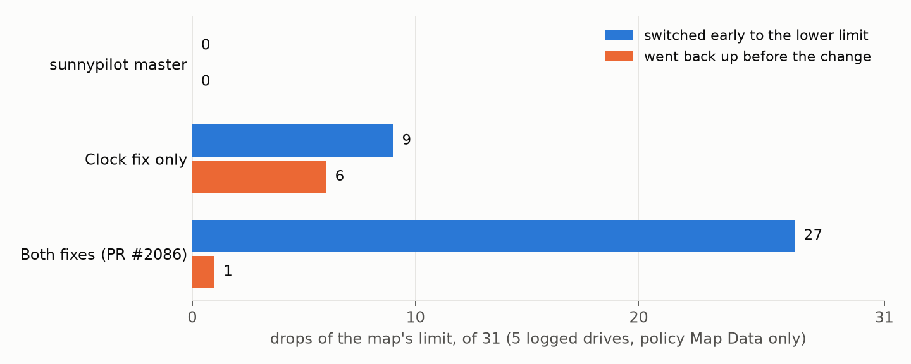
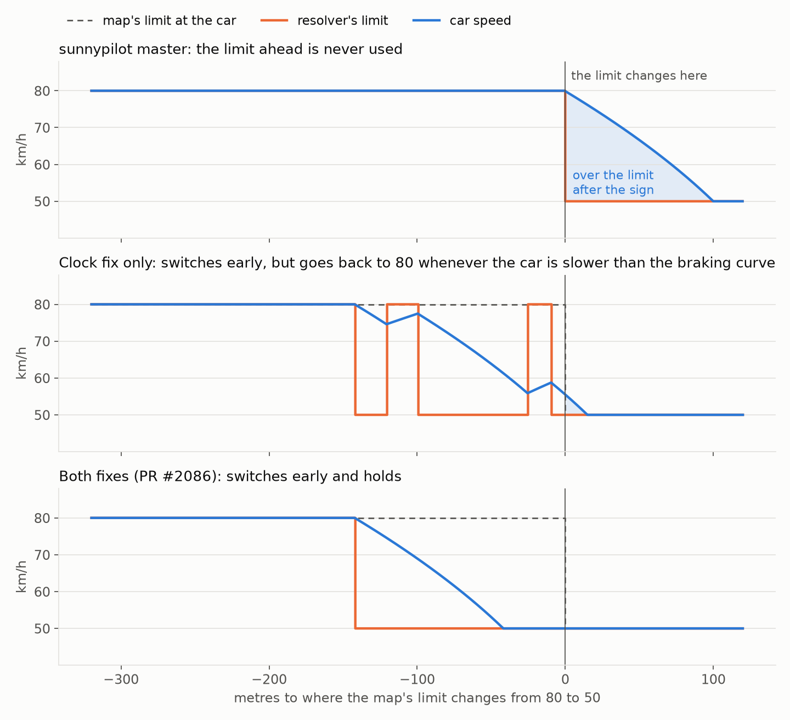

# Speed Limit Resolver: the map's "limit ahead" never kicked in. Fix in PR #2086

**TL;DR**: when the map knows that a lower limit is coming, sunnypilot is supposed to start slowing down *before* the change point. On master this never happens, because of a clock mix-up. [PR #2086](https://github.com/sunnypilot/sunnypilot/pull/2086) fixes it and makes the early switch hold until the change point.

## What should happen

mapd publishes the next limit and its distance (`liveMapDataSP.speedLimitAhead` / `speedLimitAheadDistance`, the "50 in 220 m" sign on the screen). When the next limit is lower than your speed, the resolver should switch to it once the distance gets shorter than the braking distance at −1 m/s² (`LIMIT_ADAPT_ACC`). That way you are already at the new limit when you reach the sign.

## What actually happens on master

There is even a `# FIXME-SP: this is not working as expected` above that code. Here is why:

```python
gps_fix_age = time.monotonic() - gps_data.unixTimestampMillis * 1e-3
distance_since_fix = self.v_ego * (time.monotonic() - gps_data.unixTimestampMillis * 1e-3)
```

`time.monotonic()` counts seconds since boot, while `unixTimestampMillis` is Unix time. On the device the difference is about **−1.79 billion seconds**, so:

- `distance_since_fix` is about `−v_ego × 1.79e9` m, so the distance to the limit ahead never gets shorter than the braking distance. **The early switch never happens**; the car only starts braking after it has passed the change point.
- The 10 s "map data too old" check never rejects anything.

The unit tests mocked `unixTimestampMillis` with `time.monotonic()`, which hid the bug.

A second issue shows up once the clock is right. The switch needed `v_ego` above the next limit, and the braking distance was computed from `v_ego`. If the car slowed down a bit faster than the braking curve, or got below the new limit before the change point, the resolver went back to the higher current limit, and the car sped up again until the change point.

## The fix (2 small commits)

1. Measure the ages on the same clock: the GPS age comes from `sm.recv_time` (monotonic), and the distance driven is counted from when `liveMapDataSP` was received, since mapd measures the distance when it sends it (1 Hz).
2. Compute the braking distance from `max(v_ego, current limit)`, so the switch holds once the car has slowed down.

```python
gps_fix_age = time.monotonic() - sm.recv_time[self._gps_location_service]
...
distance_since_map_data = self.v_ego * (time.monotonic() - sm.recv_time['liveMapDataSP'])
distance_to_speed_limit_ahead = max(0., map_data.speedLimitAheadDistance - distance_since_map_data)
...
v_start = max(self.v_ego, speed_limit)
if 0. < next_speed_limit < v_start:
  ...
```

New tests cover the early switch in five cases:

- beyond the braking distance;
- within it;
- with the distance driven since the map data arrived;
- holding once the car is already slower;
- not holding before the braking distance.

## Replayed on real drives

I replayed 5 of my logged drives through the resolver (policy Map Data only), covering 31 drops of the map's limit:



- **master**: 0 early switches. The bug makes it impossible.
- **Clock fix only**: 9 early switches, and it went back up to the higher limit 6 times before the change point.
- **Both fixes**: 27 early switches. Only one went back up, when mapd itself stopped announcing the limit ahead.

## What it looks like

This is a simple simulation, not a logged drive: a car at 80 km/h approaching an 80 → 50 change. The car brakes at 1.5 m/s² and accelerates at 0.8 m/s², and the resolver is read once a second.



## What it does not change

- **Higher limit ahead** (50 → 60): still no early switch, by design. You do not speed up before the sign.
- **The car's own limit and the other sources**: untouched. Only the map part of the resolver changes.

Feedback and logs are welcome, especially from anyone driving with Speed Limit Assist and the map as a source. The PR is [#2086](https://github.com/sunnypilot/sunnypilot/pull/2086).
